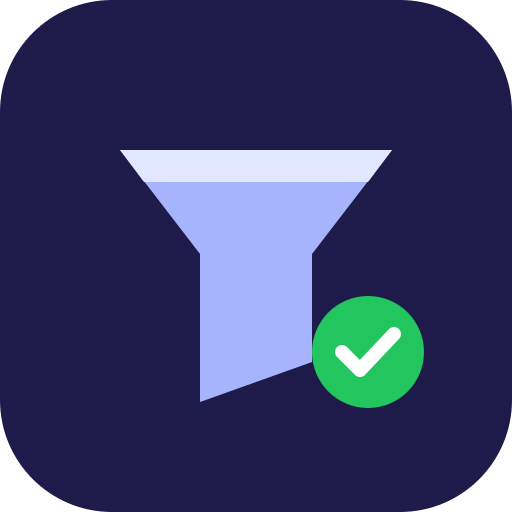

<p align="center"></p>

# Solo CRM MCP

[](https://github.com/ppiotis/solo-crm-mcp/actions/workflows/ci.yml)


**A minimal CRM your agent can run for you, safely.** Contacts, deals with stages, follow-ups, an activity log, a pipeline summary with weighted forecast, and outreach drafts. Built for solopreneurs and freelancers who don't want a SaaS CRM. Everything lives in **one JSON file on your machine**, and **every change is previewed and requires your confirmation**.

## Why

Agents are great at "log that call and remind me Friday", but a CRM that writes silently is a liability. Solo CRM makes every write a two-step **preview → confirm** with a cryptographic token bound to the exact change, so the agent must show you what it will do before it does it. It can draft outreach, but **it cannot send anything**: it has no network access.

## Tools

**Read-only** (`readOnlyHint: true`)

| Tool | Purpose |
|---|---|
| `list_contacts` | Search by text or tag; includes open-deal count |
| `get_contact` | Contact + deals + open follow-ups + recent activity |
| `list_deals` | Filter by stage, contact, open only |
| `list_follow_ups` | Sorted by due date, flagged `overdue` / `due_today` / `upcoming` |
| `pipeline_summary` | Per-stage counts and value, weighted forecast, win rate, stale deals, overdue follow-ups |
| `draft_outreach` | Email/DM draft from CRM context (`intro`, `follow_up`, `proposal_nudge`, `check_in`, `thank_you`, `reengage`). **Never sends.** |

**Writes**: two-step, `readOnlyHint: false`

| Tool | `destructiveHint` | Purpose |
|---|---|---|
| `upsert_contact` | true (updates overwrite fields) | Create or update; preview shows a from → to diff; blocks duplicate emails |
| `delete_contact` | true | Deletes contact and cascades to their deals, follow-ups and activities (counts shown in preview) |
| `upsert_deal` | true | Create or update (stage changes are recorded in `stage_history`) |
| `delete_deal` | true | Deletes a deal |
| `add_follow_up` | false | Schedule a reminder |
| `complete_follow_up` | false | Mark done |
| `log_activity` | false | Log call / email / meeting / DM / note |

Stages: `lead → qualified → proposal → negotiation → won / lost` (forecast weights 10/25/50/75/100/0%).

### The confirmation protocol

1. Call a write tool **without** `confirm_token` → `{"status":"preview","summary":…,"changes":…,"confirm_token":…}`. Nothing is written.
2. The agent shows you the preview.
3. The agent calls again with **identical arguments + `confirm_token`** → `{"status":"applied",…}`.

Tokens are HMAC-SHA256 signed with a per-process random key and bound to the tool name, the exact arguments and the current store revision. They expire after 10 minutes and are single-use, and any other change to the CRM invalidates them. A token from one preview cannot apply a different change.

## Install

### Local (recommended)

Requires Node.js 20+. Add the plugin, or put this in `.mcp.json`:

```json
{
  "mcpServers": {
    "solo-crm": {
      "command": "npx",
      "args": ["-y", "github:ppiotis/solo-crm-mcp"],
      "env": { "SOLO_CRM_PATH": "/absolute/path/to/crm.json" }
    }
  }
}
```

Default data file: `~/.solo-crm/crm.json` (created on first confirmed write, mode `0600`, folder `0700`).

From source: `git clone https://github.com/ppiotis/solo-crm-mcp && cd solo-crm-mcp && npm ci && npm run build && node dist/stdio.js`

### Remote (Streamable HTTP)

`node dist/serve-http.js` serves stateless Streamable HTTP at `/mcp` (and `GET /health`). Because the CRM is a local file, run it on a machine you control, e.g. a home server or private VPS, with a token:

```bash
SOLO_CRM_PATH=/data/crm.json MCP_AUTH_TOKEN=change-me HOST=0.0.0.0 PORT=3000 node dist/serve-http.js
docker build -t solo-crm-mcp . && docker run -p 3000:3000 -v "$HOME/.solo-crm:/data" -e SOLO_CRM_PATH=/data/crm.json -e MCP_AUTH_TOKEN=change-me solo-crm-mcp
```

Client: `{"url":"https://your-host/mcp","headers":{"Authorization":"Bearer change-me"}}`. Put TLS in front (Caddy / Cloudflare Tunnel). Do not expose it publicly without `MCP_AUTH_TOKEN`.

| Env var | Default | Purpose |
|---|---|---|
| `SOLO_CRM_PATH` | `~/.solo-crm/crm.json` | Data file (must end in `.json`) |
| `MCP_AUTH_TOKEN` | unset | HTTP only: require a bearer token |
| `HOST` / `PORT` | `127.0.0.1` / `3000` | HTTP bind |

## Security & privacy

- **No network, no telemetry.** The server never makes outbound requests. Runtime deps: the MCP SDK and `zod`.
- **Human-in-the-loop writes.** Preview → confirm with bound, expiring, single-use tokens (unit-tested: wrong args, reuse, stale revision, malformed, expired).
- **Accurate MCP annotations** on every tool (`readOnlyHint`, `destructiveHint`, `idempotentHint`, `openWorldHint: false`).
- **Can't send messages.** `draft_outreach` returns text with `"sent": false`.
- **Data safety.** Atomic writes (temp file + rename), serialised in-process; private file permissions; a corrupt file is reported and never overwritten.
- **Validated input.** zod schemas for every field (emails, ISO dates, ISO currency codes, id formats, length caps).
- **No secrets** in code or config. The optional HTTP bearer token is compared in constant time.

## Reviewer test plan

Setup: add the plugin with `SOLO_CRM_PATH` set to a scratch file, e.g. `/tmp/solo-crm-review.json`.

1. **Preview gate.** Ask: *"Add Sam Rivera (sam@rivera.studio) from Rivera Studio, and a $800 logo deal at proposal stage."* → Expect a preview of both changes and a question asking you to confirm, with **no file created yet**. Say "yes" → both applied; the file now exists.
2. **Follow-ups.** Ask: *"Remind me to nudge Sam on 2026-01-05, then what's overdue?"* → Expect preview → confirm, then `list_follow_ups` showing the item as `overdue`.
3. **Pipeline.** Ask: *"How's my pipeline?"* → Expect `pipeline_summary`: 1 open deal, $800 open value, $400 weighted forecast, the proposal stage listed.
4. **Draft, never send.** Ask: *"Draft a proposal nudge to Sam."* → Expect a subject draft that names the deal (subject "Re: proposal for <deal title>"), and an explicit note that nothing was sent.
5. **Destructive guard.** Ask: *"Delete Sam."* → Expect a preview stating it will PERMANENTLY delete the contact plus 1 deal and 1 follow-up. Say "no" → the file is unchanged.

## Development

```bash
npm ci
npm test               # build + unit tests + e2e over stdio and Streamable HTTP
npm audit --omit=dev
```

## License

MIT © Paris Piotis
